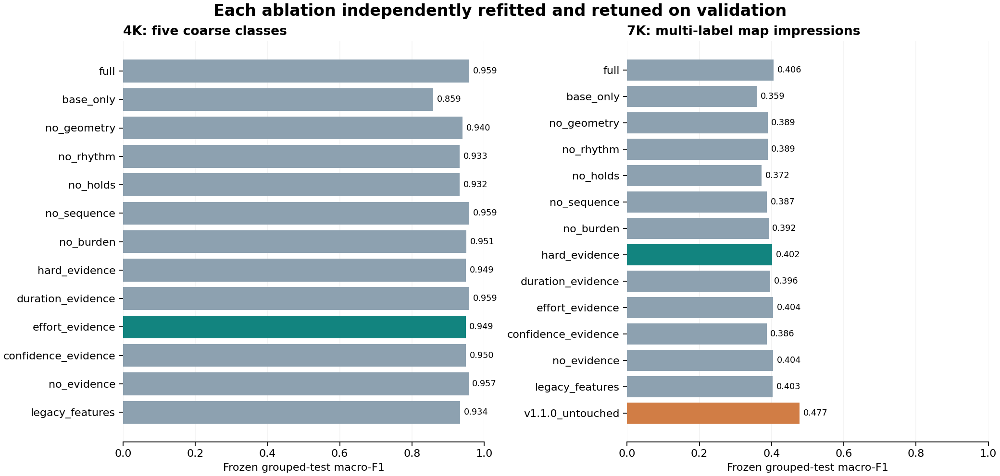
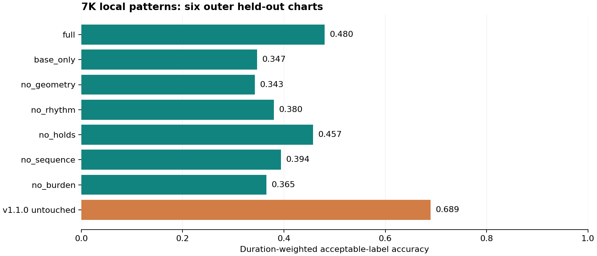

# SPMTagClassifier v1.2.0 研究报告

**历史版本记录。** 当前采用决定、完整联合研究和原生 6K 方案见 [回炉结论](rework/CONCLUSIONS.md)。本文下面的现代头、投影融合与分阶段指标对应已发布 v1.2.0，不描述当前开发分支。

**2026-10-30 勘误：** 本文保留已发布版本的数值记录；撤回“完整联合调参”及完整旧特征公平对照的说法。旧整谱搜索先按局部代理目标选择局部头，再调下游；`legacy_features` 只含窗口摘要，不含原完整 56 项段落特征与专家流程。因此这些结果不能解释为“修正旧局限后反而更差”。重做协议与新证据见 [回炉研究](rework/README.md)。

日期：2026-10-30。代码、模型、参数搜索、分组划分、逐谱预测及本报告随同版本发布。

## 结论与生产选择

- **4K**：支持 jack / ln / speed / stamina / tech。按验证集选中的 `effort_evidence` 在分组测试集上的 macro-F1 为 **94.87%**。这验证的是整谱粗分类；没有 4K 人工分段真值，局部输出只是弱监督迁移。
- **7K**：新特征及新头部已实现并经过分阶段搜索，新整谱模型 `hard_evidence` 的测试 macro-F1 为 **40.20%**，原模型为 **47.72%**。因此默认保留原 7K 分类决定；新模型通过 `algorithm: 'modern'` 显式启用。
- **分段**：六谱外层留一评估中，新完整特征方案的时长加权准确率为 **48.03%**，原模型为 **68.92%**。完整消融结果见下；少量长谱的自然语言标注不能代表全部玩家群体。
- **6K**：提供五类整谱粗分类及 7K 风格细分段落。粗分类融合权重通过 4K/7K→6K 投影验证集选择；细分分布采用键数的重心外推 `(6−4)/(7−4)=2/3`。**本地没有 6K 键型真值，代理测试结果不是实际 6K 准确率。**

## 数据、划分与评价口径

7K 主集 393 条记录 / 391 文件，其中 40 条无键型标注；去除与六张精标谱同组的 4 条有标注记录后，整谱研究使用 349 条。训练/验证/测试记录数为 [206, 73, 70]，独立组数为 [112, 36, 37]。17 个整谱标签包含 anchor；唯一泛称 chordstream 合并到 dense chordstream，避免仅一例的新类别。所有映射、排除项及真值均可检查。

4K 共 1,349 条，34 条 course 不作为局部键型类别，使用剩余 1315 条。训练/验证/测试记录数为 [789, 263, 263]，组数为 [379, 118, 112]。细分 sub-pattern 不当作新增监督类别。

分组取规范化歌曲身份、基础曲名、正数 beatmap/set ID 和速率归一事件序列重复关系的传递闭包。变速副本及同曲/同谱组不能跨训练、验证、测试。固定种子 20261030；5 折分组划分的第 0 折为测试，第 1 折为验证，其余训练。没有通过不断换种子挑选漂亮结果。

整谱是多标签任务：独立二分类模型输出支持分数，以验证阈值选标签，空集时取最大分数。macro-F1 在整个固定标签表上计算，包含稀有及测试中缺失类别；micro-F1、sample-F1、精确匹配和逐类 support 一并保存。只有 3 个 ln wildcard、5 个 vibro 等稀有标签，macro-F1 方差较大，不能只看总准确率。

原 v1.1.0 内嵌模型的历史训练样本并未随插件公开，可能已经见过本地部分标签。其固定预测比较反映已有产品表现。`legacy_features` 重新训练只用了旧窗口摘要，虽使用相同划分，但不是完整原算法的同等条件比较。六谱基线也有历史暴露限制。

ApoLar 292 张谱另作正例诊断：排除与主集/精标谱同歌曲或同正数 ID 的谱，以及没有明确 jack 标注的记录后，剩余 **227** 张。粗 jack 检出率为原模型 **88.99%**、新模型 **95.59%**。这说明新模型对这个 jack 子域更敏感；没有负例就无法测特异度，不能把检出率称为总体准确率，也不足以推翻主集与分段的负结果。详细排除项和逐谱预测均已保存。

## 当时的分阶段参数搜索与消融

每个删除版本都重新拟合标准化、本地分类器和整谱分类器，并在相同验证集重新选择参数。不是在已调好的模型上仅把一个特征置零。主研究共记录 **8,532** 个局部/整谱/分段搜索候选，另有 **288** 个行合并敏感性候选；迁移与 sort 搜索单独保存。

- 窗长：2 / 4 / 8 秒；输出步长固定 2 秒，作为时间分辨率契约。
- Logistic C：0.03 / 0.3 / 3；类别权重：无 / balanced。
- 整谱阈值：0.25 / 0.4 / 0.55；分段温度：0.5 / 1 / 2；Viterbi 切换惩罚：0 / 1 / 3。
- 整谱证据：硬标签、时长/窗口平均、负荷加权、最大支持分数加权、两者联合、以及完全不使用分段证据。
- 行合并：0 / 5 / 10 ms。0、5 ms 的完整特征方案重新搜索全部窗长、C、类权重和阈值；10 ms 主研究同时比较所有特征组。验证集未选择替换原 10 ms 约定。该敏感性实验不包含“所有特征子集×所有行合并值”的高阶交互穷举。
- 对几何/持键的删除同时移除其衍生 effort，避免以另一个特征名字泄漏被消融的信息；这两个版本及 no_burden 不再按 effort 加权。

分段使用六个外层留一测试折，每折另留一张谱作内层验证，其余四张精标谱及主集训练部分的纯标签谱用于拟合。每个外层折的全部 162 个候选（3 窗×3 C×2 类权重×3 温度×3 惩罚）独立搜索，七个特征版本均如此。按预测区间与所有标注区间的真实交集时长计分；任一备选人工标签命中即接受，问号与未标注尾部不计分。短段并没有被悄悄删除以抬高得分。

一次初步运行后，代码测试发现相接尾/头不应合并为既有持键，随即修正、重新提取并重跑最终研究。该初步运行的测试数值没有用于参数或结构选择；本报告只使用最终候选。模型文件保留训练部分的实际拟合，不在测试后悄悄全量重训成另一个候选。

### 4K：重新调参后的整谱结果

| 消融版本 | 验证集 macro-F1 | 测试集 macro-F1 | 测试集 micro-F1 | 整组精确匹配 |
|---|---:|---:|---:|---:|
| full | 96.30% | 95.90% | 95.82% | 95.82% |
| base_only | 89.10% | 85.88% | 85.71% | 83.27% |
| no_geometry | 94.51% | 94.01% | 93.70% | 90.87% |
| no_rhythm | 93.41% | 93.26% | 93.41% | 92.40% |
| no_holds | 96.09% | 93.18% | 93.56% | 93.16% |
| no_sequence | 95.90% | 95.89% | 95.82% | 95.82% |
| no_burden | 95.64% | 95.11% | 95.06% | 95.06% |
| hard_evidence | 95.96% | 94.93% | 94.90% | 94.30% |
| duration_evidence | 95.95% | 95.90% | 95.82% | 95.82% |
| effort_evidence | 96.50% | 94.87% | 94.90% | 94.30% |
| confidence_evidence | 95.95% | 94.96% | 94.92% | 93.92% |
| no_evidence | 95.92% | 95.68% | 95.64% | 95.44% |
| legacy_features | 93.57% | 93.38% | 93.18% | 92.78% |

### 7K：重新调参后的整谱结果

| 消融版本 | 验证集 macro-F1 | 测试集 macro-F1 | 测试集 micro-F1 | 整组精确匹配 |
|---|---:|---:|---:|---:|
| full | 44.72% | 40.61% | 65.06% | 54.29% |
| base_only | 33.45% | 35.93% | 50.66% | 18.57% |
| no_geometry | 39.06% | 38.93% | 54.90% | 30.00% |
| no_rhythm | 44.85% | 38.92% | 59.89% | 42.86% |
| no_holds | 37.97% | 37.21% | 60.38% | 55.71% |
| no_sequence | 44.74% | 38.70% | 65.77% | 60.00% |
| no_burden | 44.06% | 39.15% | 61.36% | 45.71% |
| hard_evidence | 46.41% | 40.20% | 66.67% | 60.00% |
| duration_evidence | 42.38% | 39.63% | 57.14% | 28.57% |
| effort_evidence | 41.93% | 40.44% | 58.00% | 30.00% |
| confidence_evidence | 43.79% | 38.63% | 61.02% | 42.86% |
| no_evidence | 40.95% | 40.41% | 57.00% | 27.14% |
| legacy_features | 39.80% | 40.31% | 57.30% | 40.00% |
| v1.1.0_untouched | 固定原模型 | 47.72% | 70.67% | 65.71% |

4K 验证集偏好 effort-only 证据，7K 新头偏好 hard evidence。联合“置信度×负荷”没有稳定胜出，因此不将联合加权作为两种键数的共同生产分类规则。负荷、熵、margin、完整分布仍作为可检查指标输出。

### 分段：外层测试结果

| 版本 | 时长加权可接受标签准确率 | 各谱面等权准确率 | 交叉熵 |
|---|---:|---:|---:|
| full | 48.03% | 46.19% | 1.604 |
| base_only | 34.72% | 34.99% | 1.875 |
| no_geometry | 34.27% | 33.22% | 1.734 |
| no_rhythm | 38.04% | 38.74% | 1.584 |
| no_holds | 45.74% | 44.45% | 1.694 |
| no_sequence | 39.44% | 37.10% | 1.739 |
| no_burden | 36.53% | 37.16% | 1.650 |
| v1.1.0 untouched | 68.92% | 69.59% | 原分数非归一概率，不直接比较 |

各外层折选择的参数、每张谱得分和逐时间交集预测均保存在 `segment-folds.json`、`segment-search.json`、`segment-test-predictions.json`。显示用新 7K 头的参数由各内层验证结果汇总选择；外层测试分数不参与这个选择。默认 7K 仍保留原分段决定，新增修正的测量与分数分布，避免在这六谱之外声称已获稳定收益。

## 6K 的迁移与验证边界

4K→6K 将两只手各 2 列对称嵌入 3 列，保留空置列；7K→6K 去除灵活中列，其余列保持左右手顺序。源谱原有组划分完全保留。复合 mix 印象标签不提供唯一粗键型，故不用于投影监督。投影会改变手感与 LN 覆盖率，这就是代理任务而非真人 6K 标签的原因。

将 7K 细标签支持合并为 jack/ln/speed/stamina/tech，与 4K 的独立支持按 λ 融合；每个固定 λ 对照都重新选择阈值。λ 搜索为 0、1/3、2/3、1，阈值为 0.25、0.4、0.55。两个源研究最初分别分组；联合迁移另剔除了 8 条跨域训练歌曲/ID 重叠记录，并检查跨域验证/测试同曲重叠，避免一个分支提前见过另一分支的测试歌曲。测试来自源测试组投影，验证 311 条，测试 306 条。

| 迁移版本 | 验证 macro-F1 | 测试 macro-F1 | λ（7K 权重） | 阈值 |
|---|---:|---:|---:|---:|
| tuned_transfer | 88.48% | 83.57% | 1.000 | 0.55 |
| pure4 | 31.79% | 36.31% | 0.000 | 0.25 |
| pure7 | 88.48% | 83.57% | 1.000 | 0.55 |
| barycentric | 86.59% | 85.71% | 0.667 | 0.55 |
| no_key_adaptation | 81.42% | 80.53% | 0.667 | 0.55 |

`no_key_adaptation` 故意把 6K 按 7 列几何测量，检验正确键数归一化的影响；其融合权重及阈值同样重新调参。细分段落保留 7K 类内结构，在粗类别质量上与 4K 分布按 2/3、1/3 组合；7K 的 Break 质量保留。没有 6K 细标签可以调这个细分权重，因此采用明确的键数重心外推。

验证选择的 λ=1，即整谱粗分类退化为纯 7K 支持。固定重心融合虽然测试分数较高，也不能据此回头更改验证选择；当前数据没有支持强行加入 4K 粗分类分支。

## 缺陷修复、额外键型与外部研究

实现与反例详见 [AUDIT.md](AUDIT.md)：LN 重复面积、尾行干扰击打邻接、相接面尾/面头、持键无头窗口、当前 timing phase，以及聚合分子/分母和 confidence 含义。相应逻辑用精确数理反例和镜像/倍速不变量测试验证；这些不变量不是玩家准确率。

anchor、trill、roll、repetition、occupancy、releaseIndependence 作为额外连续描述量输出。只有具有主集标注的 anchor 进入 7K 研究整谱标签表；没有为零标注的新键型编造分类准确率。外部项目调研、固定提交及采用/未采用理由见 [REFERENCES.md](REFERENCES.md)。

## 全量运行与交付物

实际运行唯一 `.osu` 文件：{'4': 1349, '6': 2343, '7': 689}。所有成功谱面检查数值有限、区间连续、局部分布归一和整体组成归一。6K 的 `bm6k_0778` 含两个尾早于头 2 ms 的对象（138235 < 138237），明确返回 `InvalidHoldTail`，未修改用户原始文件，未把它计作成功分类。

全量 QA 同时修复了旧分段器漏掉短起拍的包络问题，并将 `bm6k_1687` 中的无限拍长 timing point 明确忽略、记录警告；确认没有训练用 4K/7K timing point 受此修复影响。29 项单元/不变量/API/浏览器包测试通过；32 张测试谱的 Python→实际 JS 模型支持最大绝对误差约 1.84×10⁻⁶（容差 10⁻⁴）。

- `src/legacy/tag-engine.cjs`：原版引擎；v1.1.0 发布前做过 391×2=782 次逐值一致性比较。
- `src/parser.cjs`、`features.cjs`、`model.cjs`、`segment.cjs`、`aggregate.cjs`：独立可研究模块。
- `src/models/`：实际使用的参数与模型；`dist/tag-engine.js`：浏览器单文件。
- `research/results/`：清单、排除项、分组、完整搜索、逐谱与逐时间预测、逐类指标、图表、运行报告。
- `scripts/reproduce.ps1`：从本地数据复现实验；`research/requirements.txt`：研究依赖版本。推理无第三方依赖。

后续最有价值的工作是新增**跨谱师的 7K 分段盲标**和**实际 6K 键型标签**，尤其是 wildcard、minijack、vibro、面技与反键边界；继续在同一六谱上加规则不足以建立泛化结论。
