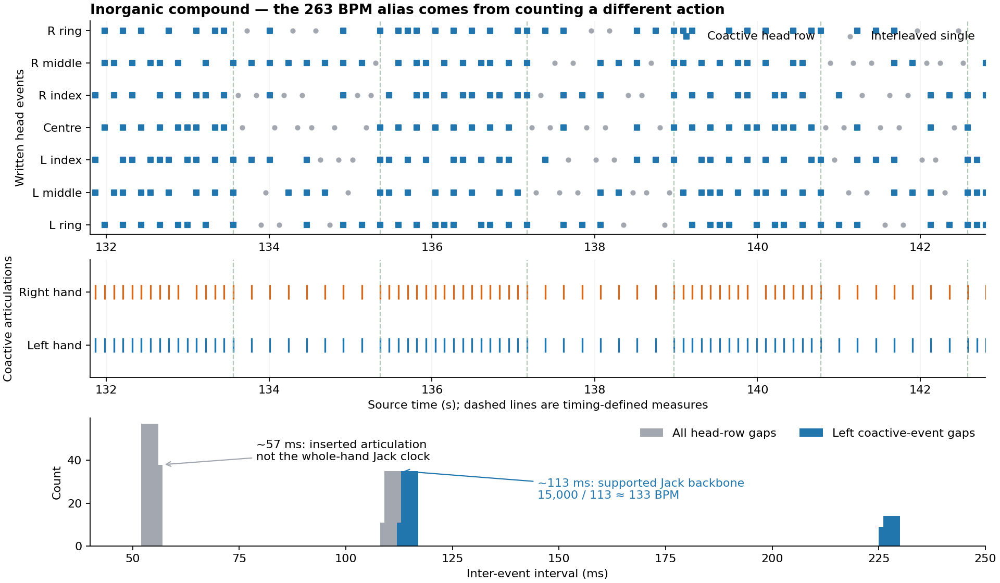
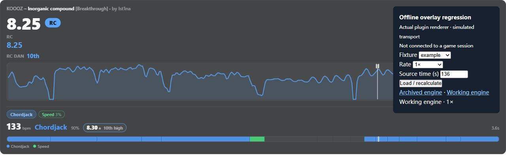

# 动作时钟与音乐分段：从 263 BPM 到有动作依据的 133 BPM

用户示例 `examplebeatmap/` 的 **131980–142582 ms** 保持 Chordjack，当前标准倍率显示 **133 BPM**；不是把旧数值除二，也没有按歌曲 BPM 或人为速度上限截断。真实插件渲染器的离线显示已核对。

本轮仍属从 **v1.1.0** 出发的同一个 **v1.2 迭代**。本次直接修补对照为 `b311c408ef02d6705d30b51a4ea789d3e86d2976`；包号仍为1.2.4，已发布 tag/资产不改写，新代码为 Unreleased。未修改用户运行中的插件/tosu。



## 问题不只是“找错了一倍的网格”

旧 `chordGapMed` 名称具有误导性：它对**全部头部行**统计间隔，而非大叠动作行。示例中主多押行约113 ms，间插单键约56–57 ms；全行中位数57 ms因此显示263 BPM。原规则特征已有约133 BPM的 `jackRunBpm`，但显示并未采用它。旧类型专家本身已有同指、重叠、切力与持键量；这次错值首先证明了**分类对象与显示测量对象脱节**。

用户确认：左右手每100 ms交错一行、同手200 ms再打，若按叠理解应是75 BPM，不是150 BPM；切的解释则不同。该构造的主类贴合度中/低，不将其伪造为高置信分类真值。

## BPM 按类型选择动作对象

| 类型 | 当前测量对象 | 与旧模型的关键区别 |
|---|---|---|
| Chordjack | 每只手的多押骨干再打间隔 | 不把两手交错频率、夹杂单键速率当整手叠速 |
| Minijack | 同手连续发音中的同指再打 | 不被另一只手插入的音符改变，也不把普通逐指 roll 当连续叠 |
| Dense/Fast CS | 两手内手指替换事件的合并流 | 是切换动作流，不套用 Jack 的单手周期除数 |
| Speed/Tech/Wildcard | 有支撑的头部发音周期 | 不再用拟合出来的更细空网格充当观测节律 |
| Coordination/Density | 有支撑的头部发音周期 | 仅说明新头节律，不声称代表持键或独立放手压力 |

等效 BPM 仍按 `15000 / 周期毫秒` 的16分音符口径换算，不是音乐 BPM。真正更快的拍击不会被封顶。缺少足够动作支撑的统一数值不显示；不规则结构仍保留类型及分支支持。

**骨干不是“只留多押然后求间隔”。** 两个骨干多押之间，共同手指可以有额外再打，表示可叠加的 Anchor/Minijack 动作；若夹杂的是共同手指之外的同手 roll，稀疏多押重音不能证明一个更慢的整手叠速。这样同时处理“叠＋锚键”和“roll中的偶发多押”，不把一个问题改成另一种半速错误。

7K 两种中心拇指归属都计算；不一致时不强选一边。很短的快速单手碎片也不能压过另一手持续的主节律。混合段的 `evidence.secondaryCadence` 可与主类 BPM 不同，例如同一事件序列 Jack75／CS150。`evidence.actions` 提供逐手同指再打、指组替换、共同按下及固定指组读数。

这些是谱面中可观测的动作约束，并非捕获到玩家真实手腕运动。当前类型 W/b 未再训练；**只改 BPM 的消融中，全部局部标签和整谱积分逐项不变**。不把测量层修复算成新类型模型的识别收益。

## 音乐边界在分类前生效

读取红线的拍长、meter、相位以及省略首小节线标志；继承的 SV/音效点不重置小节。实现依据 [osu!官方格式说明](https://osu.ppy.sh/wiki/en/Client/File_formats/osu_%28file_format%29#timing-points)。音乐 timing 是弱先验，不等同于音频分句检测。

- 对已有变化候选，优先吸附**一拍以内**的有效小节线；不强行每小节切一段。
- 保留谱面端点、最小父段约束；明显头部空隙和持键无新头区域不为排版整齐而挪动。无有效 timing 时原样返回，不伪造120 BPM网格。
- 调整 `windowRange`，重新计算新段的 extras 和专家分数；不是只移动显示条。
- 没移动的边界端点保留原窗口索引，避免短 pickup 或末尾窗口被无意重新解释。
- 分数毫秒的小节线按源文件的毫秒时间格归属，保证被截断/取整的小节首键进入后一段；同时保留理想音乐时间 `nominalTime`，不把量化误差当成音乐相位变化。
- 旧整体参考预测器保留**原分段、原权重**，与新段共享已计算的特征窗口，不重复评分。

新父段仍复用了原1秒特征窗口，因此边界附近仍有上下文混入；本轮没有宣称完成音乐语义或瞬时局部动作识别。

## 完整声明空间和消融

**动作钟：** 60配置 = 间隔支撑门槛5档 × 多押宽度权重3档 × 手部持续支撑4档；68个机制构造 × 3倍率 × 镜像 × 2相位 = **816情形/配置**。当前无宽度权重、严格多数0.5、手部支撑0.5满足816/816约束。其它门槛有同分平地；选择多数和半数持续支撑来自动作计数直觉，不把它们说成数据唯一确定的最优点，也不把构造通过率叫玩家 BPM 准确率。新示例没有用于选择这些数值。

**音乐分段：** 初始关/0.5/1/2拍 × 最近/对比排序的完整对照保留；六张人工谱中两种排序相同。随后审查全部411输入的1233组候选，发现26个谱面/半径组合不同（半径1有2个、半径2有24个），不能把六图的相同外推到全集。对这些差异补做实际回放，其余相同输入复用；所有7个设置都有完整411×3输出。

**与休息门控联调：** 初始4半径（含关闭）×3个confidenceFloor×3个lowNpsScale×3消费器为108配置；上述全集候选审查后，把对比排序也补齐，最终 **189配置**。边界相同的输入复用完整原预测，只重放真实差异。关闭音乐先验臂也独立重选，不把旧参数设为不可动的 oracle。使用前次 Break 研究同一分数：0.30人工逐谱分段准确率＋0.15正确分母的Break F1＋0.15真实八局部准确率＋0.40整谱macro-F1。半径与排序在三消费器间共用，门槛各自选择；最终采用一拍、最近排序，三消费器均重新选中floor0.5、scale1。完整9格剖面显示它们在本轮目标下优于相邻档，不是跳过了联调。

**四臂实际消费器消融：** 旧实现、只改动作钟、只改音乐/门控、两者同时；每臂覆盖411输入×3消费器。最终维护引擎与选参重放的百分数最大差为 **0**；未受影响的既有基线和记录复用有效证据。窗口索引审查发现23个父段/半径组合涉及8个输入；随后修复源毫秒首键归属，对三个半径分别重放313/328/333个输入，再完整重选。原草稿、每次修复及复用范围均保留。

全部是已有研究资料上的**回顾性开发比较**。18个INNER范围、6个来源外层选择也保留，但类型 W/b 曾见过历史标签，不能把来源范围内的门槛选择包装成全新盲测。

## 实际收益与代价

下面比较当前修补前 checkpoint 与最终组合，均按实际可见时间线评分；不是把旧父段统计与新显示统计相减。

| 指标 | 修补前 | 当前 |
|---|---:|---:|
| Detailed/Compact 六图逐谱分段准确率 | 72.3687% | **73.3754%** |
| 无评分动作版六图准确率 | 71.7214% | **72.7280%** |
| 评分路径把正常时间误报为Break | 47.4715s | 47.6590s（+0.1875s） |
| 评分路径真Break漏识别 | 134.1050s | **124.8880s** |
| 评分路径Break P/R | 82.86/63.12% | **83.36/65.66%** |
| Detailed 整谱macro P/R/F1 | 64.11/55.68/58.77% | 63.67/55.41/58.49% |
| Compact 整谱macro-F1 | 56.9551% | **57.2801%** |
| 动作版整谱macro-F1 | 57.4008% | 56.8704% |
| 真实八局部主类覆盖 | 62.5% | 62.5% |
| 评分路径秒内显示碎段 | 41 | **38** |

Detailed 的LN Mix F1下降2.19个百分点、Hybrid下降1.98、Coordination下降1.80；Technical上升2.12。不能称为整谱指标全面提高。动作版macro-F1也下降0.53个百分点；评分路径的收益主要是真Break少漏识别，误报时间反而略增0.1875秒，不能沿用量化修复前草稿中“误报下降”的结论。六图主要收益来自EE，BE/RJ各有约0.08/0.09个百分点小降。已知Tech→Dense错误约3012 ms基本不变，不能据此宣称解决了这个类型问题。

来源范围选择后，评分路径六图准确率约72.561%，较直接对照增加约0.192个百分点；不是全量采用的+1.007个百分点被当成外层成绩。完整逐类P/R/F、各图、外层和参数网格见结果文件。

**BPM覆盖有实际取舍：** 在只改动作钟、保持原分类时间线的消融臂中，Detailed 活动时间中附带标量BPM的比例由73.21%降至61.21%；Chordjack自身为96.57%→92.07%，Tech为100%→40.74%。后者常没有单一支撑周期，当前选择保留键型、不给猜测值。没有这些不规则段的人工数值真值，因此只报告覆盖和变更，不伪造BPM准确率。

示例在1×为133，DT为200；HT的已判Chordjack部分为100，但开头仍有旧的无评分Break误判，音乐吸附还把其结束位置延后约0.40源秒。这是保留的反例，未为单张谱硬改门控。它要求活动压力与类型支持的进一步解耦，而不是给该谱建立白名单。

## 已检查的实际显示



图中评分由原插件评分器正常计算，tag使用新引擎；离线驱动不连接用户的游戏/tosu。只用于核对本例的局部Chordjack/133 BPM和音乐边界，不据此归因原始v1.1整谱标签到本轮小修。

小节首键量化修复前的全量单次分析中位约46.5 ms、P95约198 ms；后续只重放受影响输入，不将局部重放计时冒充新的全量性能基准。静态浏览器构建与Node公共API一致；最终89项产品测试、类型检查和构建通过，见[验收记录](results/validation.json)。游戏/tosu实时链路未验收。

## 值得继续的方向

**首选：按类条件的动作骨干/附加角色进入类型专家，而不是再堆一组全局网格特征。** 可建立整手再打、共同指锚键、逐指roll、手内替换、持键锁定、独立/引导放手的候选图；同一时间允许多种动作角色。每个类型消费自己的动作支撑、周期和覆盖，而不是共享一个被所有乱键牵走的BPM。用既有局部/混合约束和整谱负担积分联合学习，比较动作固定/动作学习、局部/联合目标的独立重调消融。当前的动作几何还没有训练进类型W/b；不能把这一步的测量改进误当作已经解决整个模型的动作理解。

研究结构可参考Etterna的[手相关/手不相关分量与CJ/Tech独立处理](https://github.com/etternagame/etterna/blob/master/src/Etterna/MinaCalc/Ulbu.h)；本轮没有照搬其4K权重到7K。此前加入普通手部计数未验证通用收益，下一步应检验角色/时序结构，而不是重复同一种残差堆特征。

**音乐先验下一步：** 将音乐候选与动作变化证据共同选边界，并在父段内真正重提局部特征；保持整谱先验与类型专家的职责清楚。需要新段级缓存、重调和完整对照，成本中等。timing设置本身不能保证音频乐句；HT反例也说明吸附不能替代活动判断。

**LN动作时钟：** 复用SPMRating头/尾/持键事件并集上的压力与引导量，仍需总压力或其它分量辅助Rbar；头部节律不能代表独立放手。涉及双模型输出合同和重新提取，成本高，沿用[前次明确保留的研究方向](../break_pressure/README.md)。

## 复核入口

- 动作实现：`src/action-clock.cjs`、`src/cadence.cjs`；音乐：`src/musical-segmentation.cjs`、`scripts/build-overlay.cjs`。
- `clock-study.cjs`：完整机制网格；`music-study.cjs`／`full-music-replay.cjs`：音乐机制及全消费器对照。
- `joint-gate-study.cjs`／`select-joint.py`：初始108及扩展189配置、来源范围选择；原始结果是压缩JSON，未删负例。
- `audit-music-ordering.cjs`：全集排序差异审查；几何相同的输入才可复用预测。
- `verify-ablation.cjs`／`analyse-ablation.py`：四臂实际静态/公共实现；先前有效输入可复用，参数和曲线版本必须匹配。
- `results/ablation-report.json`：所有整谱/局部/覆盖结果；`joint-full-grid.json`、`joint-inner-selections.json`：全量网格。
- 复现需要本地dataset和既有native曲线；不重新调用评分器。较早冷检查点在`research-archives/2026-11-12/`，本轮不要求全部恢复。

完整重放使用本仓库及三个暖输入：`.cache/perception-final-resource.jsonl`、`.cache/local-feedback-activity-r6b/manifest.json`、`.cache/core-retune-parents-r2.jsonl.gz`。在仓库根目录依次运行：

```powershell
node research/action_clock/clock-study.cjs
node research/action_clock/full-music-replay.cjs
node research/action_clock/joint-gate-study.cjs
node research/action_clock/audit-music-ordering.cjs
node research/action_clock/full-music-replay.cjs --extend-contrast
node research/action_clock/joint-gate-study.cjs --extend-contrast
python -X utf8 research/action_clock/report.py
python -X utf8 research/action_clock/select-joint.py
node research/action_clock/verify-ablation.cjs
python -X utf8 research/action_clock/analyse-ablation.py
```

`--repair-file`／`--refresh-music` 是本轮保存修复前记录并局部重放的执行入口，不是完整复现的额外步骤。完整重放会覆盖当前结果；历史中间记录仍用于核对过程，不应混入最终候选。
