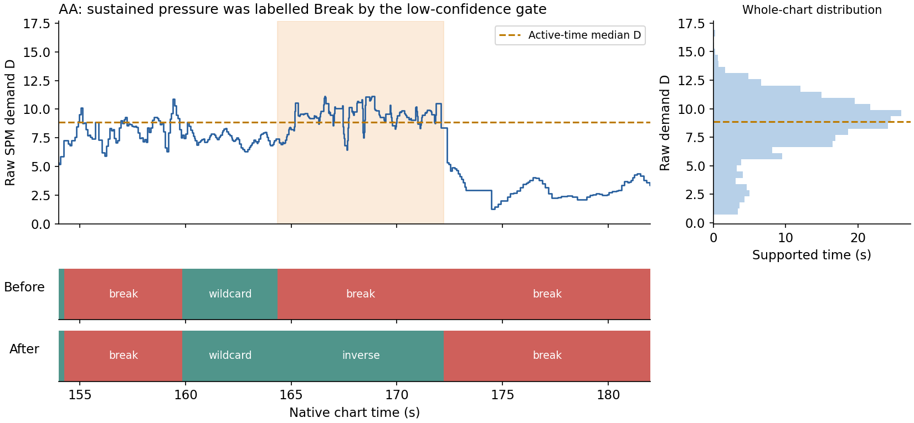

# 修补持续高压力段被判为 Break

本次是同一 v1.2 迭代内的小范围修补。对照为 `184408e` 的默认参数；研究基线仍为 v1.1.0。没有改动类型专家 W/b、家族路由、评分模型或原始归档。

## 原因：SPM 难度在 Break 判完之后才被读取

原管线先按 NPS、节奏、段内和弦及低类型支持判断 Break，再在整谱聚合里读取 SPM 曲线。Break 的所有类型支持为零，因此后来的高难度权重不能挽回前面的错误。原 56 维类型向量和 Break 门控都没有瞬时 SPM 分布输入。

对当前 411 条输入的 8,483 个自然段追踪：1,536 个 Break 可由提前的 `lowStakes` 单独解释，50 个来自末尾门控，140 个同时受多层影响，302 个已在初始 `markBreaks` 标记，40 个没有有效打击行。这是输入级追踪，重复谱不算独立样本；初始标记也不等于已证实的真休息段。

例如 `manual/AA` 的 **164.351–172.226 秒**，原始需求场 D 的时间分布大部分高于该图有效时间中位数，却因类型支持低、NPS 相对偏低，被改成 Break。现在恢复为 Inverse；真实插件离线渲染器在 168 秒显示 Inverse，段均难度 8.93★、峰值 10.09★。

图中 D 是原始需求场，**不是星级**；星级只用于上述实际界面读数。

## 采用：持续压力证据否决两条软休息判断

已计算的 Detailed／Compact `query`、`demand` 先通过既有模型身份、倍率和原生头部时钟验证，再进入 Break 门控。只复用输入，不调用评分器。

1. D 按原生头部时钟右连续读取，用毫秒而非音符数加权。
2. 相邻头部间隔达到原有 `restGapMs=2500` 时，不将前一个 D 贯穿这段长空隙；最后一个头部之后也不外推 D。这样避免把残留的高 D 当作持续压力。
3. 当一段至少 **50% 的完整持续时间**，有受时钟支持的 D 不低于全图有效时间 D 的 **50% 分位数**，它不再仅因 `lowStakes` 或 `easyAmbiguous` 被改成 Break。
4. 保留初始 `markBreaks`、空行及 `shortSparse` 处理；不从难度直接猜类型，恢复时仍由当前专家提供标签和分支支持。
5. 固定旧参考预测器仍使用原门控；只改变当前局部读出。`classic`、`legacy`、modern、4K／6K 不受影响。

没有 SPM 曲线时不伪造 D，也不额外运行评分。动作版仍走原路径。`modelInfo.breakPolicy` 记录是否用了难度、参考 D、参数及触发保护的自然段数；保护不覆盖后续的独立稀疏规则。

## 结构修补和旧旋钮一起联调

不是先补一个条件，再把旧参数视为不可动。每个消费器均独立完成以下声明空间：

- 旧低类型支持门槛：0.35／0.50／0.65。
- 旧低 NPS 两个门槛的共同倍率：0.75／1.00／1.25；原 18.5／22.5 分别乘此倍率。
- 难度参考分位：0.50／0.75／0.90。
- 持续压力占整段时间的门槛：0.25／0.50／0.75。
- 只保护早期 `lowStakes`，或同时保护早期和晚期。

无难度输入臂 **9** 个组合；有难度输入臂包括自己的无输入对照共 **171** 个组合。Detailed、Compact 分别选参，动作版另行选择，共 351 套配置、18 个 INNER 来源范围，全部完成。固定原有规则中的相对 NPS 0.85、行速率 16、物理 gap／稀疏常量和类型 W/b，未扩成一次完整版本重训。

选择综合逐谱分段准确率、正确分母的 Break F1、真实八局部和整谱 macro-F1；没有逐指标零退步否决。两个评分消费器都选中“分位 0.5、持续比例 0.5、两层保护”，旧门槛重新选择后仍为 0.5／1.0。无输入臂重调后也选择旧参数。

原协议与全网格在 `results/tune-r1/`。最初重复计算各子集指标过慢，改成每配置缓存预测；`execution-repair.json` 保留修复，缓存与未缓存的完整基线指标对象逐项相等。参数空间、选参准则和预测公式不变。

## 实际效果与代价

下面使用完整原六图和 349 张标签集合；**它们是已有研究资料上的回顾性开发重放**。类型 W/b 曾见过这些资料，不作为新盲测。

| 指标 | 修补前 | 接入难度后 |
|---|---:|---:|
| 六图逐谱分段准确率 | 71.7214% | **72.3687%** |
| 正常键型时间误报为 Break | 55.1965 秒 | **47.4715 秒** |
| 真 Break 漏识别时间 | 133.9175 秒 | 134.0675 秒 |
| Break 精确率 | 80.6254% | **82.8633%** |
| Break 召回率 | 63.1703% | 63.1290% |
| Detailed 整谱 macro-F1 | 58.1211% | **58.7703%** |
| Compact 整谱 macro-F1 | 56.9678% | 56.9551% |

Detailed 的整谱宏 P／R 为 **64.1083%／55.6820%**；Compact 为 **64.3683%／52.5243%**。真实八局部保持 62.5%，Tech→Dense 的 3,012 ms 没有改变。动作版全部 411 条的整谱输出和局部时间线与修补前相同。

来源分组外层选择流程中，Detailed F1 为 58.7703%，Compact 为 56.6293%；六图准确率两者均为 71.7214%，未显示跨来源局部增益。外层差异在于 AA 留出时选择了仅早期保护，另有 Compact 一折选择更严格的持续比例。完整逐折、逐类 P/R/F1 保留，不把全量采用的局部收益改称外层提升。

实际 411 条输入、三个消费器已重放并与独立研究预测核对，百分数最大差约 `2.33e-12` 个百分点。评分消费器共有 292 条输入／消费器时间线改变，不将其称作 292 张独立谱。显示段从 7,776 到 7,788，秒内段保持 41。71 项产品测试、类型检查通过；单谱三路径分析中位约 48.7 ms、P95 189.4 ms。

首次原生重放发现策略没有传进内部分类调用，结果为零修正；该失败保存在 `native-unwired.json`。修复实际传参后，公共 API 回归测试和最终独立整谱／百分数／局部核对均通过。最终证据为 `native.json`、`product-report.json`，不是首次失败结果。

## 值得继续的方向：保留，但本次不扩做

**首选下一步：按真实物理空隙补切分，并识别跨空隙持键。** `markBreaks` 目前会因为自然段内部出现一次长头部空隙，把整个自然段标成 Break；一个长段可能同时有难段和空隙。应在“头／尾／持键”的物理时间线上明确切出空闲区，而不是把整个父段翻回活动。这需要重建分段缓存并完整复核边界、局部标签和聚合，成本中等；此次保留该分支没有证明它正确。

**最高结构收益：把活动／压力与类型贴合分开建模。** 低置信度 Technical、Wildcard 或混合段，并不等于没有游玩压力。当前 D 否决只是小补丁；独立活动后验可由相对／绝对难度、头尾速率、持键变化与类型支持共同驱动，再接类型头和短时状态平滑。需要新增监督或人工复核“难但不典型”的段落，重新联合拟合与消融，成本高。

**必须和 SPMRating 协同的时钟升级：头尾事件并集上的压力场。** 当前对外 D 只在头部行上采样。长 LN 无新头但需要独立放手、持键变化的时间，可能没有新样本；在长空隙中沿用旧 D 又会产生假高压。真正的解决方案是共享头／尾／持键事件时钟上的可衰减压力，保留 Rbar、Pbar 等分量和总量；Rbar 必须配总 D 或其它分量，不能单独用绝对值判 Release。涉及评分输出合同、双模型及倍率时钟、全缓存重提取，成本最高。

**跨谱绝对压力与无评分降级路径。** 当前是图内相对分布，仍可能漏掉“绝对很难，但低于本图中位数”的段落；也不修没有评分输入的误判。可研究经 OD／倍率归一的绝对压力锚，或用共享物理中间量训练轻量代理，不能给缺失 D 补零或默默重跑完整评分。本次参考分位在声明域下边界，后续可结合新标注和绝对锚扩域，不宣称已找到性能上限。

## 位置与复核

- 运行实现：`src/break-pressure.cjs`；参数：`src/models/break7k.json`。
- `audit.cjs`：所有 Break 来源与原始 D 分布；`extract.cjs`：一次提取有效时钟支持；`study.py`：完整联调；`verify.cjs`／`report.py`：实际维护引擎及独立数值核对；`plot.py`：上图。
- 当前真实重放入口：`node research/break_pressure/verify.cjs`，然后 `python -X utf8 research/break_pressure/report.py`。需要既有本地数据和缓存；不重复评分。
- 已发布 v1.2.4 的 tag／资产保持；新代码仍是同一 v1.2 迭代的未发布更新，没有修改用户运行中的插件。
