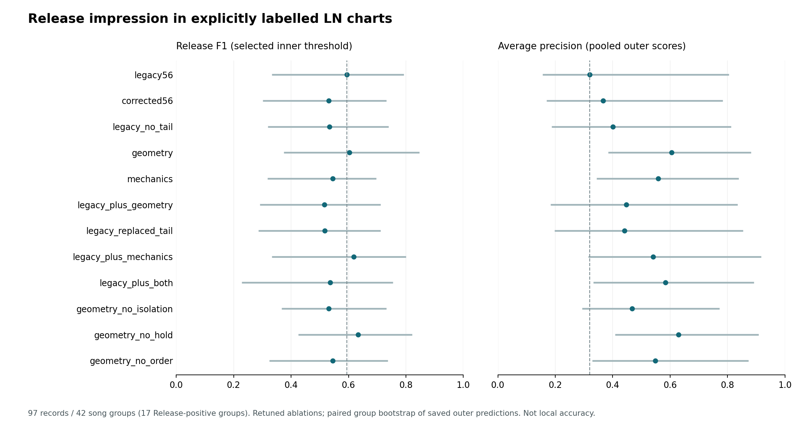

# Release 研究：事件几何有信息，直接拼接没有成为更好的决策器

任务是复现明确 LN 细标签中的**整谱 Release 印象**，不是检测任意 Release 成分是否存在，也不是局部 Release 准确率。97 条记录来自 42 个歌曲/谱面组，28 条 Release 阳性来自 17 个组；重复物理文件总权重为 1。Rice-only、Mix-only、wildcard-only、未标注和六张精标谱均未混入这个二分类任务。

## 每项消融重新拟合，并同时选择参数和阈值

六个外层歌曲组折，各用内层三折联合选择 C、类别权重、按时长/effort 池化，以及内层概率可以形成的全部不同阈值分割。标准化仅用训练折。第一次结果在共同 C 边界多次取最优，因此把**所有消融**的共同范围扩到 `1e-5…1e3`，复用 5,184 项有效旧拟合，只新增 2,592 项内层拟合；所选配置不变的外层预测也复用。

原56、修正56、删旧 tailInd、九项几何、27项机制、拼接、替换，以及几何中隔离/持键/次序三项消融均完整比较。机制表示使用固定难度模型先验，历史训练暴露未知。

| 表示 | binary macro-F1 | Release F1 | AP | 分折平均 AP | Δmacro-F1 的95%组区间（百分点） |
|---|---:|---:|---:|---:|---:|
| legacy56 | 69.53% | 59.38% | 32.01% | 65.38% | [+0.0, +0.0] |
| corrected56 | 64.84% | 53.12% | 36.63% | 55.53% | [-9.9, -1.0] |
| legacy_no_tail | 66.06% | 53.33% | 40.10% | 63.45% | [-8.7, +1.5] |
| geometry | 70.47% | 60.32% | 60.47% | 79.19% | [-8.3, +13.1] |
| mechanics | 68.15% | 54.55% | 55.87% | 72.08% | [-13.6, +7.4] |
| legacy_plus_geometry | 64.27% | 51.61% | 44.78% | 64.32% | [-10.1, -1.6] |
| legacy_replaced_tail | 65.41% | 51.72% | 44.06% | 68.15% | [-10.5, +0.8] |
| legacy_plus_mechanics | 73.24% | 61.82% | 54.10% | 70.22% | [-7.1, +9.9] |
| legacy_plus_both | 67.23% | 53.57% | 58.42% | 67.26% | [-14.0, +4.2] |
| geometry_no_isolation | 64.84% | 53.12% | 46.75% | 69.88% | [-18.4, +11.7] |
| geometry_no_hold | 73.33% | 63.33% | 62.90% | 82.12% | [-5.7, +12.8] |
| geometry_no_order | 65.37% | 54.55% | 54.82% | 75.99% | [-13.1, +4.3] |

原完整流程的固定硬决策在这批记录上的 Release F1 为 **81.63%**。其历史训练暴露未知，不能作为双方训练材料相同的泛化优胜；也未把硬标签伪称为连续概率来与新模型比较 AP。

## 采用什么，暂不采用什么

独立释放几何值得保留：它能观察到原 Rbar 在头部采样栅格上漏掉的孤立尾事件，也能保留没有中间头部行的连续释放次序。但直接拼接原56，在本任务的 macro-F1 从 69.53% 降至 64.27%，成对组区间为 −10.1 至 −1.6 个百分点；不采用直接拼接作为默认方案。九项几何单独使用的 macro-F1 增益区间跨零；持键消融的较高点估计也不足以断言持键没有意义。

合并 AP 还受到不同外折模型分数标度的影响。原56的外折同时选到了 balanced/非 balanced 类别权重和差异很大的正则化：某折阳性平均支持为 0.284，另一折阴性平均为 0.562。因此表中同时报告分折平均 AP；移除有效训练类别先验的后验诊断见 `prior-score-diagnostic.json`，不把该变换冒称为重新调参后的分类收益。

接下来优先检验**保留原专家、限制更新容量的 LN 条件适配**，再与原生分段及聚合联调，而不将这个二分类器塞回全部局部类别头。精标 Release 仅五个区间、两个阳性谱来源，局部结论仍应使用这些真实独立支持。

完整搜索、选参、逐折训练数据、模型和外层预测见本目录 JSON；区间与逐折 AP 见 `metrics-with-intervals.json`。区间由保存的外层预测按歌曲组重采样，已见数据的回顾性比较不冒充全新盲测。

说明勘误：首轮协议的池化文字误写为 legacy burden；执行源码一直读取现代特征缓存的 `effort`，扩展轮协议已按实际含义写明。数值计算与旧拟合复用均未改变。
