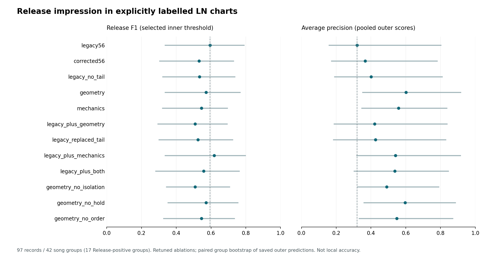

# Release 整谱印象：重调后的表示消融

任务是复现明确 LN 细标签中的**整谱 Release 印象**，不是检测任意 Release 成分是否存在，也不是局部 Release 准确率。97 条记录来自 42 个歌曲/谱面组，28 条 Release 阳性来自 17 个组；重复物理文件总权重为 1。Rice-only、Mix-only、wildcard-only、未标注和六张精标谱均未混入这个二分类任务。

## 每项消融重新拟合，并同时选择参数和阈值

六个外层歌曲组折，各用内层三折联合选择 C、类别权重、按时长/effort 池化，以及内层概率可以形成的全部不同阈值分割。标准化仅用训练折。所有消融使用同一扩展范围 `1e-5…1e3`；本轮复用 3,888 项有效拟合，新拟合 3,888 项。所选配置及输入均不变的外层预测也复用。

原56、修正56、删旧 tailInd、九项几何、27项机制、拼接、替换，以及几何中隔离/持键/次序三项消融均完整比较。机制表示使用固定难度模型先验，历史训练暴露未知。

| 表示 | binary macro-F1 | Release F1 | AP | 分折平均 AP | Δmacro-F1 的95%组区间（百分点） |
|---|---:|---:|---:|---:|---:|
| legacy56 | 69.53% | 59.38% | 32.01% | 65.38% | [+0.0, +0.0] |
| corrected56 | 64.84% | 53.12% | 36.63% | 55.53% | [-9.9, -1.0] |
| legacy_no_tail | 66.06% | 53.33% | 40.10% | 63.45% | [-8.7, +1.5] |
| geometry | 69.75% | 57.14% | 60.19% | 83.93% | [-9.3, +8.8] |
| mechanics | 68.15% | 54.55% | 55.87% | 72.08% | [-13.6, +7.4] |
| legacy_plus_geometry | 63.38% | 50.79% | 42.06% | 66.17% | [-11.8, -1.9] |
| legacy_replaced_tail | 65.16% | 52.46% | 42.64% | 64.13% | [-8.2, -1.0] |
| legacy_plus_mechanics | 73.24% | 61.82% | 54.10% | 70.22% | [-7.1, +9.9] |
| legacy_plus_both | 67.56% | 55.74% | 53.70% | 66.61% | [-11.3, +4.0] |
| geometry_no_isolation | 63.38% | 50.79% | 49.04% | 75.72% | [-19.7, +9.1] |
| geometry_no_hold | 69.75% | 57.14% | 59.68% | 82.14% | [-12.3, +10.4] |
| geometry_no_order | 65.37% | 54.55% | 54.82% | 75.99% | [-13.1, +4.3] |

本轮先修复释放序列的端点同时音歧义：三组尾时刻均为单个事件时才定义三指先后。原固定边界缓存中 1,311 项次序坐标改变，其他八项逐值一致。不含该坐标的消融保留有效拟合；含该坐标的消融重训全部配置，不沿用旧选参。

原完整流程的固定硬决策在这批记录上的 Release F1 为 **81.63%**。其历史训练暴露未知，不能作为双方训练材料相同的泛化优胜；也未把硬标签伪称为连续概率来与新模型比较 AP。

## 采用什么，暂不采用什么

事件几何能观察到原 Rbar 在头部采样栅格上漏掉的孤立尾事件，并保留没有中间头部行的连续释放次序。直接拼接原56，macro-F1 从 69.53% 变为 63.38%，差值95%组区间为 [-11.8, -1.9] 个百分点；未支持直接拼接作为更好的决策器。各消融的点估计及区间见表，不用外层最高点选择特征或模型。

合并 AP 还受到不同外折模型分数标度的影响，因此同时报告分折平均 AP。原56相关训练先验的后验诊断保存在 `../release-impression-r2/prior-score-diagnostic.json`；该变换未作为重新调参后的分类收益。

接下来优先检验**保留原专家、限制更新容量的 LN 条件适配**，再与原生分段及聚合联调，而不将这个二分类器塞回全部局部类别头。精标 Release 仅五个区间、两个阳性谱来源，局部结论仍应使用这些真实独立支持。

完整搜索、选参、逐折训练数据、模型和外层预测见本目录 JSON；区间与逐折 AP 见 `metrics-with-intervals.json`。区间由保存的外层预测按歌曲组重采样，已见数据的回顾性比较不冒充全新盲测。

说明勘误：首轮协议的池化文字误写为 legacy burden；执行源码一直读取现代特征缓存的 `effort`，扩展轮协议已按实际含义写明。数值计算与旧拟合复用均未改变。

优化审计：7,776 项内层拟合、72 个外层模型；最大训练梯度分别为 7.13e-06 / 4.9e-07，接受阈值 1e-5。
